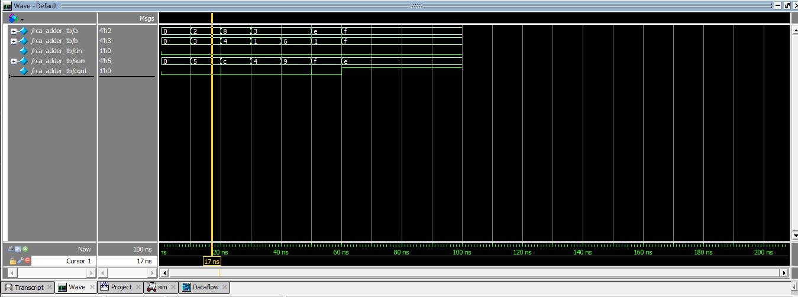

# Project 01 - 4-Bit Ripple Carry Adder

## Description
4-bit RCA built using 4 Full Adders - Structural modeling in Verilog.

## Files
- full_adder.v - 1-bit FA
- rca_adder.v - 4-bit top module
- rca_adder_tb.v - Testbench
- rca_adder_waveform.png - QuestaSim waveform

## Logic
Sum = A ^ B ^ Cin
Cout = (A & B) | (B & Cin) | (A & Cin)

## Tool
QuestaSim

## Waveform
